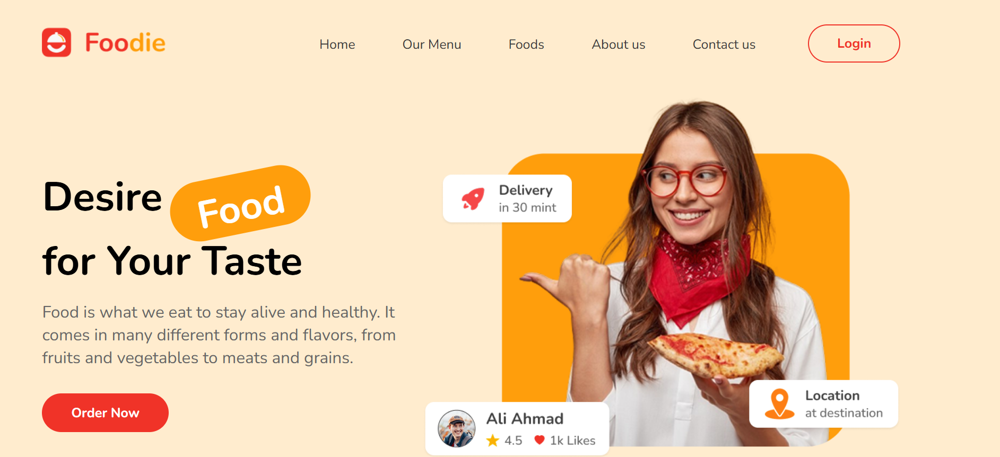
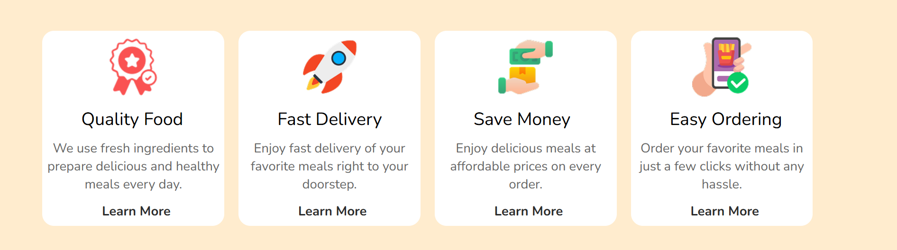
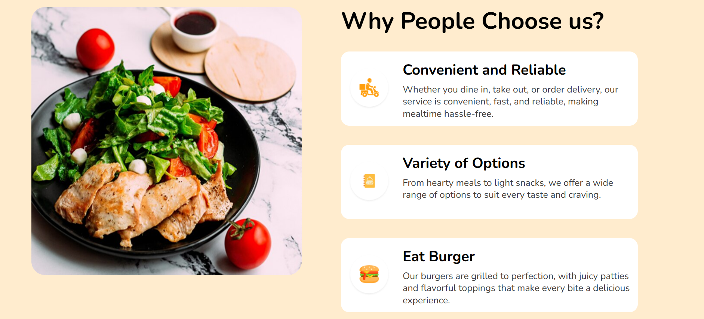
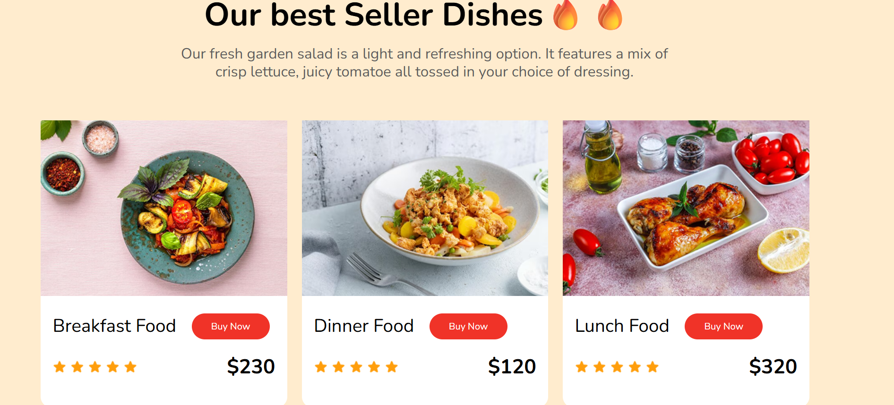
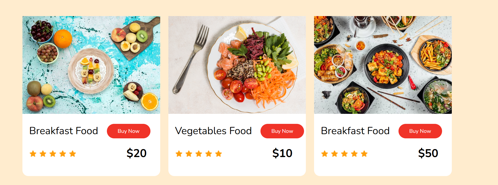
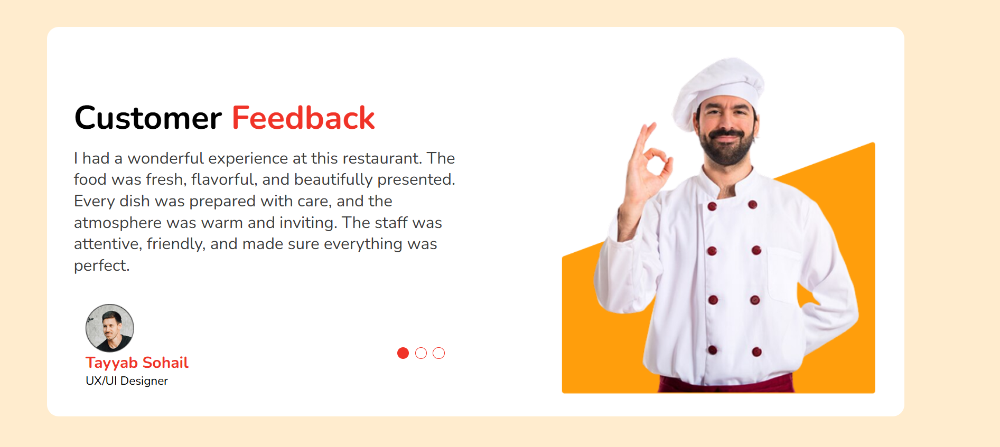
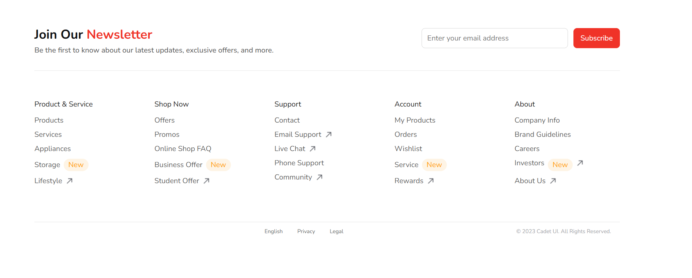

# Foodie

Foodie is a modern food website designed to showcase delicious meals, popular dishes, and convenient food ordering. It features a clean interface, attractive food imagery, and interactive elements to create an enjoyable user experience.

## Features

- **Navigation Bar** — navigation links for Home, Our Menu, Foods, About Us, and Contact Us.
- **Hero Section** — an introduction to Foodie with an Order Now button.
- **Food Categories** — four categories highlighting quality food, fast delivery, affordable prices, and easy ordering.
- **Why Choose Us** — information about convenient service, a variety of food options, and delicious burgers.
- **Best Seller Dishes** — a collection of six dishes featuring images, prices, and ratings.
- **Customer Feedback** — a customer review section with interactive review navigation.
- **Newsletter Section** — an invitation to subscribe to updates and exclusive offers.

## Implementation

- **Interactive Elements** — hover effects, animated buttons, and dynamic content.
- **Reusable Components** — modular UI components built with React.

## Technologies Used

- React
- JavaScript
- HTML5
- CSS3
- Vite

### Prerequisites

Make sure you have Node.js and npm installed on your computer.

### Installation

1. Clone the repository:

   ```bash
   git clone https://github.com/annaivastudent/my-restaurant.git
   ```

2. Navigate to the project directory:

   ```bash
   cd my-restaurant
   ```

3. Install dependencies:

   ```bash
   npm install
   ```

4. Start the development server:

   ```bash
   npm run dev
   ```

5. Open the local URL displayed in your terminal to view the website.

## Project Structure

```text
my-restaurant/
├── public/
├── src/
│   ├── assets/
│   ├── components/
│   ├── img/
│   │   ├── logo/
│   │   ├── items/
│   │   ├── dishes/
│   │   ├── icons/
│   │   ├── customers/
│   │   └── chefdishes/
│   ├── App.jsx
│   ├── App.css
│   ├── index.css
│   └── main.jsx
├── index.html
├── eslint.config.js
├── vite.config.js
├── package.json
└── README.md
```

## Design

The website features a modern food-themed design with vibrant red accents, rounded buttons, food photography, and interactive hover effects.

## Author

Anna Ivanova — [GitHub](https://github.com/annaivastudent)

## Screenshots








